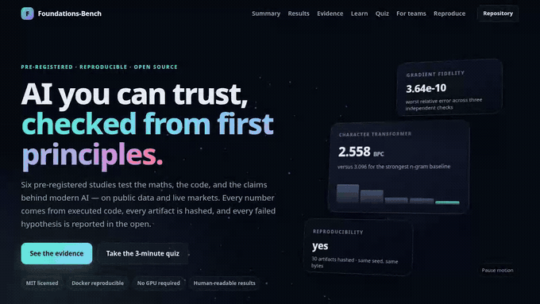
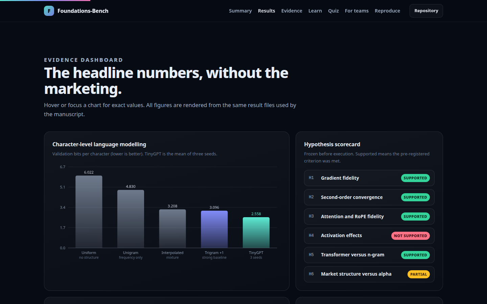
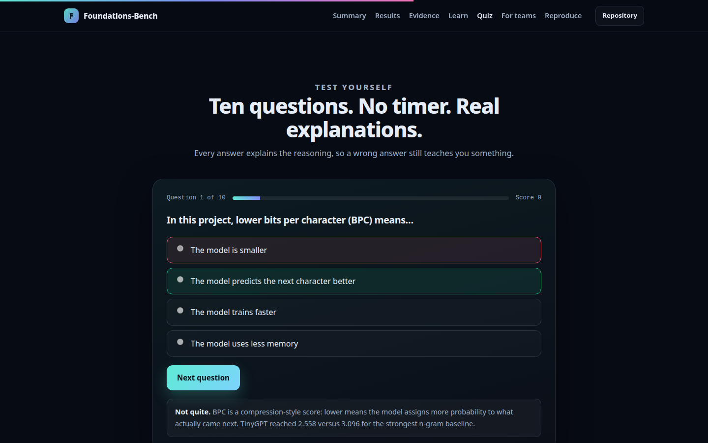
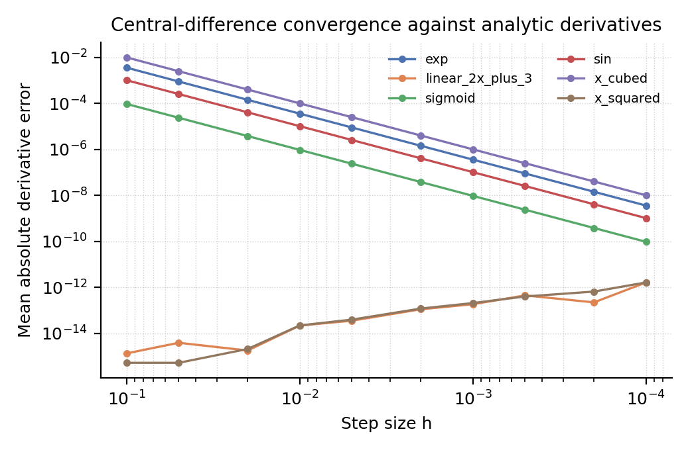
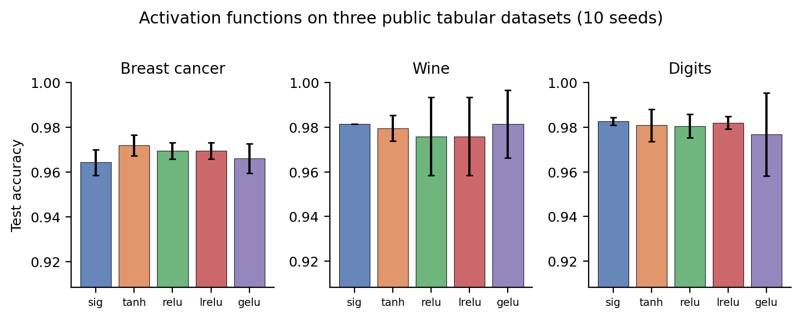
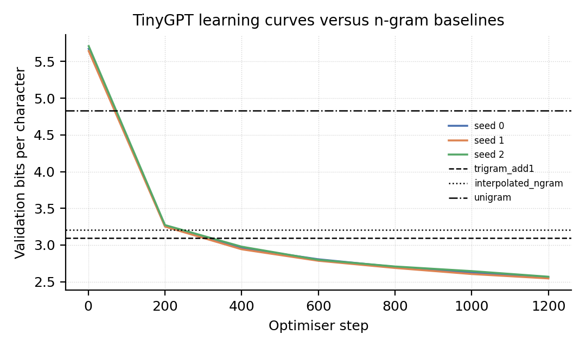
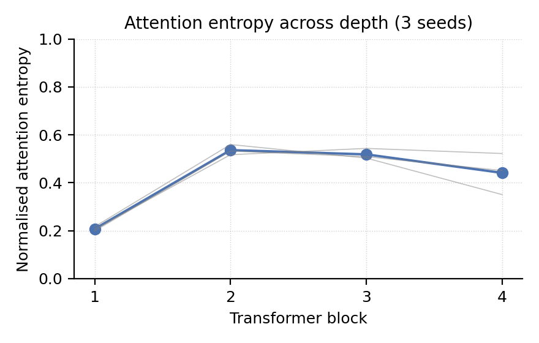
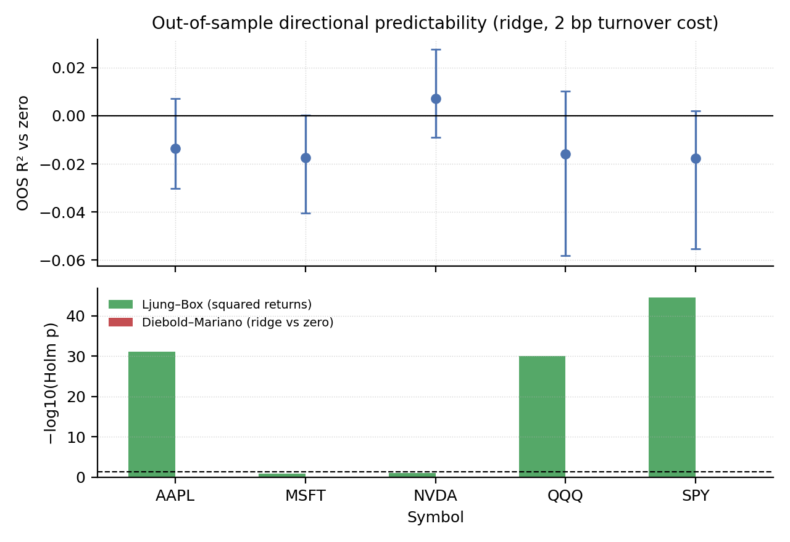

<div align="center">

# Foundations-Bench

### AI you can trust — checked from first principles.

**Six pre-registered studies. 4 of 6 hypotheses supported. Every number executed, hashed, and reproducible.**

[](LICENSE)
[](pyproject.toml)
[](tests/)
[](#headline-results)
[](Dockerfile)
[](#quick-start-in-30-seconds)

**[Open the interactive preview](https://M0-AR.github.io/foundations-of-ai-benchmark/preview.html)** · **[Take the 3-minute quiz](https://M0-AR.github.io/foundations-of-ai-benchmark/preview.html#quiz)** · **[🌱 Beginner guide](#-beginner-guide--read-this-and-you-are-a-professional)** · **[Headline results](#headline-results)** · **[Quick start](#quick-start-in-30-seconds)**

**Live pages:** [home](https://M0-AR.github.io/foundations-of-ai-benchmark/) · [preview.html](https://M0-AR.github.io/foundations-of-ai-benchmark/preview.html) · [docs/preview.html](https://M0-AR.github.io/foundations-of-ai-benchmark/docs/preview.html) — all three render the same self-contained page.



<sub>18-second tour of the real site (4.0 MB GIF). <a href="docs/assets/demo.mp4">MP4</a> · <a href="https://M0-AR.github.io/foundations-of-ai-benchmark/preview.html">full screen</a> · no sign-up, no tracking, no external assets.</sub>

</div>

---

## The 30-second version

**For the person who has three minutes and a meeting.**

> **What it is.** An independent, open-source lab that checks whether the maths and the claims behind modern AI actually hold up — and publishes the failures as carefully as the wins.
>
> **What we found.** 4 of 6 pre-registered hypotheses were supported. H1, H2, H3 and H5 passed their stated thresholds. H4 was not supported after Holm correction, despite a significant omnibus Friedman test on one dataset and a maximum paired effect size of |d_z| = 1.23. H6 was only partially supported: Ljung–Box rejected in 3 of 5 symbols, while Diebold–Mariano rejected in 0 of 5.
>
> **Why it matters.** AI claims are cheap. Evidence is not. This repository gives a buyer, a board, a customer, or a candidate the code, the data hashes, and the statistics to check a claim instead of trusting a slide.
>
> **What it costs to verify.** Nothing. MIT license, CPU only, no API keys, about 15 minutes for the full suite.

| The question a busy person asks | The short answer |
|---|---|
| Did the mathematical foundations check out? | Yes. The worst gradient error is **3.64e-10**, attention matches the reference to **8.88e-16**, and causal leakage is exactly **0.00e+00**. |
| Does a small transformer beat a strong classical baseline? | Yes. **2.5582** bits per character versus **3.0958** for a smoothed trigram — **17.4%** lower, across all seeds. |
| Can you make money from the market result? | No. Volatility clusters in **3 of 5** symbols, but next-day direction survives costs in **0 of 5**. Structure is not alpha. |
| Can someone else reproduce it? | Yes. Retraining is byte-identical (**yes**) and 30 files are SHA-256 hashed. |
| Is this a product pitch? | No. It is a public benchmark under the MIT license. Use it, fork it, audit it, or challenge it. |

**The one-sentence takeaway:** *most AI claims fail not because the maths is hard, but because nobody checks the boring parts — and this project checks the boring parts in public.*

---

## What is this, in plain English?

Think of a building inspection. You do not need to be a structural engineer to ask whether the walls are straight, the wiring is safe, and the fire exits open. You need someone independent to test those things and show you the report.

**Foundations-Bench is an inspection report for AI claims.** It rebuilds the core ideas from scratch — the derivative engine, the neural network, attention, a small transformer — and then tests whether they do what their textbooks say. It also runs the same discipline on two empirical questions: whether a transformer really beats a classical language model, and whether stock-market structure is the same thing as a tradeable edge.

The project is deliberately small. That is the point. A laptop can run it end to end, so the evidence is not hidden behind a cluster, a proprietary dataset, or a vendor's slide deck.

### What is actually inside

| Layer | What was built from scratch | How it is checked |
|---|---|---|
| Calculus | Central differences, analytic derivatives, a scalar reverse-mode autograd engine | Against finite differences and PyTorch in double precision |
| Neural network | A NumPy MLP with hand-derived gradients | Against finite differences and PyTorch on identical weights |
| Attention | Causal multi-head attention and rotary position embeddings (RoPE) | Against PyTorch's fused attention; zero future leakage; Toeplitz structure |
| Language model | A 0.8M-parameter decoder-only character transformer | Three seeds against four n-gram baselines on Tiny Shakespeare |
| Markets | Walk-forward ridge regression on five liquid US symbols | Ljung–Box, Diebold–Mariano, bootstrap intervals, turnover costs |
| Reproducibility | A byte-level determinism audit and SHA-256 manifest | Two identical runs; every artifact hashed |

### What this is not

It is not an LLM leaderboard, a frontier-model evaluation, a trading strategy, or investment advice. The transformer is intentionally tiny, the tabular datasets are intentionally small, and the market sample is five symbols over five years. The goal is **traceable truth at a small scale**, not a claim about the largest systems in the world.

---

## Why it matters

1. **Procurement needs proof, not adjectives.** "State of the art", "trusted", and "production-ready" are not test results. This repo shows what a test result looks like: a fixed protocol, a fixed seed set, a result file, and a hash.
2. **Due diligence is cheaper when the evidence is public.** A reviewer can inspect the code and rerun the suite before a contract, a pilot, or an acquisition — instead of paying for a black-box audit.
3. **Hiring needs a real signal.** A candidate who can explain gradients, backpropagation, attention, and multiplicity correction has something more durable than trivia. The beginner guide and quiz are built for that conversation.
4. **Teaching needs honest failures.** Most courses show a clean success story. This one shows a hypothesis that failed after correction, and a market claim that dissolved after costs. Those are the lessons that transfer.
5. **Reproducibility is a business asset.** If a number cannot be regenerated, it is a story. If it can, it is evidence. Every table and figure here is generated from `results/*.json`.

---

## Who it is for

| Reader | What you get | Time |
|---|---|---|
| **Business leader** | The 30-second summary, the headline table, and the business-value section | 3 minutes |
| **Buyer, consultant, or auditor** | A due-diligence checklist, public hashes, and a one-command reproduction path | 15 minutes |
| **Engineer** | From-scratch implementations, property tests, and a working transformer | 1–2 hours |
| **Student or interview candidate** | A ten-step beginner guide, a quiz with explanations, and code links for every idea | 1–2 hours |
| **Researcher** | A frozen pre-registration, deviations, result JSON, and generated tables | 30 minutes |
| **Skeptic** | The two failed hypotheses, the limitations, and the exact commands to prove us wrong | As long as you like |

---

## What you can do with it

- **Audit a vendor claim.** Ask for the protocol, the seeds, the endpoints, and the result files. This repo is a template for what those should look like.
- **Onboard engineers fast.** Trace one idea at a time from a derivative to a working transformer, with runnable code at every step.
- **Teach a course or a workshop.** Use the beginner guide, the quiz, and the six studies as a ready-made curriculum.
- **Interview for understanding.** Ask a candidate to explain why H4 failed, or why volatility clustering does not imply alpha.
- **Build an internal baseline.** Fork the harness and substitute your own data, model, or hypothesis — keeping the pre-registration and reporting discipline.
- **Stress-test a paper.** Reuse the gradient, attention, and reproducibility checks before you build on someone else's result.
- **Demonstrate good practice.** Show a team what negative results, multiplicity correction, and hashed artifacts look like in practice.
- **Start a conversation.** Open an issue with a claim you want tested, a result you want challenged, or a study you want added.

---

## Headline results

| ID | Hypothesis                      | Primary endpoint              | Pre-registered criterion  | Observed                                      | Supported |
|----|---------------------------------|-------------------------------|---------------------------|-----------------------------------------------|-----------|
| H1 | Gradient fidelity               | max relative error            | < 1e-5                    | 3.64e-10 (worst of 3 checks)                  | yes       |
| H2 | Calculus convergence            | median log–log slope          | >= 1.8                    | 2.000                                         | yes       |
| H3 | Attention / RoPE fidelity       | parity, leak, RoPE invariants | all thresholds            | parity 8.88e-16; leak 0.00e+00; RoPE 6.22e-15 | yes       |
| H4 | Activation effects              | Holm p and \|d_z\|            | p < 0.05 and \|d_z\| >= 0.5 | min Holm p = 0.209; max \|d_z\| = 1.227       | no        |
| H5 | Transformer vs smoothed trigram | mean val BPC                  | lower, all seeds, >= 5%   | 2.5582 vs 3.0958 (17.4% lower)                | yes       |
| H6 | Live market structure vs alpha  | LB / OOS R² / DM              | clustering; no alpha      | LB Holm rejects 3/5; DM Holm rejects 0/5      | partial   |

### How to read the score

4 of 6 hypotheses met their **pre-registered** criteria. That is the honest score, not a marketing score.

- **H1, H2, H3, H5 passed.** The numerical foundations are exact at machine precision, and the small transformer beats the strongest n-gram baseline on every seed.
- **H4 failed after correction.** One activation pair looked large before multiplicity correction, but no pair survived Holm correction across 30 tests. The raw effect was not enough.
- **H6 is partial.** Volatility clustering appears in three of five symbols; no symbol shows a Holm-significant next-day directional edge after costs. The strict all-symbol claim fails on both halves.
- **E6 passed.** Retraining from the same seed produces byte-identical parameters, and the manifest hashes every artifact.

The failures are not footnotes. They are the reason to trust the wins.

---

## 🌱 Beginner guide — read this and you are a professional

**This section assumes zero background.** No calculus, no linear algebra, no finance. Read it in order, open the code links when you are curious, and say each sentence out loud once. By the end, you will be able to hold your own in a technical conversation. **You will know more than most interview candidates.**

Let's work this out in a step-by-step way to be sure we have the right answer. Each step has three parts: the idea in plain English, where it lives in the repository, and a sentence you can use in an interview or a meeting.

### 1. A function is a machine

A function takes an input and returns an output. A coffee grinder takes beans and returns grounds. A model takes a prompt and returns a next character. The useful question is not "is the machine clever?" but "what does it do to each input, and how sensitive is the output to a small change?"

**In the repo:** [`experiments/e1_calculus_autograd.py`](experiments/e1_calculus_autograd.py)

**Say this:** "A function maps inputs to outputs; a derivative tells me how sensitive the output is to a small change in the input."

### 2. A derivative is a sensitivity; a gradient is a list of them

A derivative is the slope at one point: nudge the input a little, see how much the output moves. A gradient is the same idea for many inputs at once — one sensitivity per input, collected into a list. If the gradient is positive, increasing that input increases the output. If it is negative, increasing the input decreases the output.

**In the repo:** [`experiments/e1_calculus_autograd.py`](experiments/e1_calculus_autograd.py)

**Say this:** "A gradient is the list of partial derivatives; it points in the direction of steepest increase."

### 3. Gradient descent walks downhill

Training is just repeated nudging. Measure how wrong the model is with a **loss**, compute the gradient of that loss with respect to every weight, and take a small step in the opposite direction. The step size is the **learning rate**. Too small and training crawls; too large and it overshoots.

**In the repo:** [`src/fbench/nn.py`](src/fbench/nn.py)

**Say this:** "Gradient descent takes a small step opposite the gradient to reduce the loss."

### 4. Backpropagation is the chain rule, applied backwards

A neural network is a chain of operations. To know how the loss depends on an early weight, you multiply the local sensitivities along the chain. Backpropagation does this from the output backwards, reusing intermediate results so the cost stays close to one forward pass.

**In the repo:** [`src/fbench/autograd.py`](src/fbench/autograd.py)

**Say this:** "Backpropagation applies the chain rule backwards through the graph and reuses intermediate results."

### 5. Autograd is a tape recorder for maths

An autograd engine records every operation as the model runs, building a graph. To get gradients, it replays the graph in reverse, accumulating local derivatives. You write the forward computation; the engine writes the backward one. This is what PyTorch does under the hood, and this repo rebuilds a small version to prove the idea.

**In the repo:** [`src/fbench/autograd.py`](src/fbench/autograd.py)

**Say this:** "An autograd engine records operations and computes exact derivatives by reverse accumulation."

### 6. A neural network is stacked functions with a twist

A **neuron** computes a weighted sum of its inputs, adds a bias, and passes the result through a nonlinear **activation function**. Stack neurons into layers and you get a **multilayer perceptron (MLP)**. Without the nonlinearity, stacking layers would collapse into one big linear function — the nonlinearity is what lets the network bend.

**In the repo:** [`src/fbench/nn.py`](src/fbench/nn.py)

**Say this:** "A neural network is a stack of affine transformations separated by nonlinearities."

### 7. Training is a loop, and seeds control the randomness

Training shuffles data into **batches**, makes predictions, computes the loss, backpropagates, and updates the weights. One pass over the data is an **epoch**. Initial weights and data order are random, so a **seed** fixes that randomness. Run the same seed twice and you should get the same result; run different seeds and you see how stable the claim really is.

**In the repo:** [`experiments/e2_activations.py`](experiments/e2_activations.py)

**Say this:** "Training minimizes a loss over batches; seeds control randomness, and validation data is held out."

### 8. Attention is a weighted lookup

For each token, attention builds a **query**, a **key**, and a **value**. The query is compared with every key; the scores become weights through a **softmax**; the output is the weighted sum of the values. A **causal mask** sets future scores to negative infinity, so a token cannot look ahead. Multi-head attention runs several of these lookups in parallel.

**In the repo:** [`src/fbench/models.py`](src/fbench/models.py)

**Say this:** "Attention computes a weighted average of values, with weights from query–key similarity; a causal mask prevents looking ahead."

### 9. A transformer is attention plus a lot of plumbing

A decoder-only transformer stacks blocks of causal attention and feed-forward networks, with normalization, residual connections, and position information. **RoPE** (rotary position embeddings) encodes relative position by rotating pairs of channels. The model is trained to predict the next character; **bits per character (BPC)** measures how surprised it is, so lower is better.

**In the repo:** [`src/fbench/models.py`](src/fbench/models.py) · [`experiments/e4_gpt.py`](experiments/e4_gpt.py)

**Say this:** "A decoder-only transformer stacks causal attention and feed-forward blocks; RoPE encodes relative position; bits per character measures surprise."

### 10. Statistics is how you avoid fooling yourself

A **p-value** is not the probability that your hypothesis is true. It is the probability of seeing data at least this extreme if the null hypothesis were true. Test many hypotheses and some will look significant by chance, so you correct with a method such as **Holm–Bonferroni**. On markets, **volatility clustering** (calm and turbulent days arrive in patches) is a robust structure; a tradeable **directional edge** is a much stronger claim, and it has to survive costs.

**In the repo:** [`src/fbench/stats.py`](src/fbench/stats.py) · [`experiments/e5_market.py`](experiments/e5_market.py)

**Say this:** "A p-value is not the probability the hypothesis is true; after many tests, correct with Holm; structure is not the same as a tradeable edge."

### You are now ready

If you can explain those ten ideas without notes, you are ready for the next conversation. **You will know more than most interview candidates.** The next step is to prove it to yourself: take the [ten-question quiz](https://M0-AR.github.io/foundations-of-ai-benchmark#quiz), then open one experiment and change a seed. The code is small enough to read.

---

## How the six studies work

| Study | Question in plain English | What is measured | Verdict |
|---|---|---|---|
| **E1** | Does the hand-written derivative engine actually compute derivatives? | Error against finite differences and PyTorch; convergence slope | Supported |
| **E2** | Do activation functions reliably change small-model accuracy? | 150 runs; paired effect sizes; Holm correction; split-half stability | Not supported |
| **E3** | Is causal attention exact, and does RoPE preserve relative position? | Parity with PyTorch; future leakage; Toeplitz deviation; gradcheck | Supported |
| **E4** | Does a small transformer beat a strong n-gram baseline? | Bits per character on Tiny Shakespeare, three seeds, four baselines | Supported |
| **E5** | Is market structure the same as a tradeable edge? | Ljung–Box, walk-forward R², Diebold–Mariano, costs, Sharpe | Partial |
| **E6** | Can the whole artifact be regenerated and verified? | Byte-identical retraining; SHA-256 manifest; seed stability | Supported |

The detailed methods, tables, and figures are in [Evidence in detail](#evidence-in-detail). Every number there is generated from the JSON written by the experiments.

---

## See it in action

The repository ships a self-contained interactive site. It works offline, has no sign-up, no tracking, and no external assets. Open the live **[home page](https://M0-AR.github.io/foundations-of-ai-benchmark/)**, **[preview.html](https://M0-AR.github.io/foundations-of-ai-benchmark/preview.html)**, or **[docs/preview.html](https://M0-AR.github.io/foundations-of-ai-benchmark/docs/preview.html)**. All three render the same self-contained page; the local copy is also in the repository.



*The evidence dashboard. Hover or focus a chart for exact values; the hypothesis scorecard includes the failures.*



*The quiz explains every answer, so a wrong answer still teaches you something.*


*The same site on a phone. The layout is responsive, the quiz is keyboard-first, and motion respects your system preference.*

---

## Quick start in 30 seconds

**Option A — just look.** Open the live [`preview.html`](https://M0-AR.github.io/foundations-of-ai-benchmark/preview.html) or [`docs/preview.html`](https://M0-AR.github.io/foundations-of-ai-benchmark/docs/preview.html). No install, no server, no network.

**Option B — verify the claims.**

```bash
git clone https://github.com/M0-AR/foundations-of-ai-benchmark
cd foundations-of-ai-benchmark
python -m pip install -e ".[dev]"
make test          # fast unit and property tests
make check         # validate artifacts and hashes
```

**Option C — reproduce everything.**

```bash
make data          # checksum-pinned text + live market snapshots
make all           # E1–E6, about 15 minutes on 28 CPU cores
make report        # regenerate README, tables, and figures from results/
```

**Option D — Docker, with the environment pinned.**

```bash
docker compose build
docker compose run --rm bench      # runs experiments/run_all.py
docker compose run --rm report     # regenerates README and figures
docker compose run --rm check      # validates provenance and hashes
```

No GPU or API key is required. E1–E4 and E6 run offline; E5 fetches the live market snapshot at run time, and the committed results record its exact hashes and retrieval times.

---

## Project map

| Path | Purpose |
|---|---|
| `preview.html` / `index.html` | Self-contained interactive preview; `index.html` is the Pages landing page |
| `docs/preview.html` / `docs/index.html` | Pages mirror, so `/docs/preview.html` and `/docs/` also resolve |
| `README.md` | This document, generated from the template and result files |
| `config/preregistration.yaml` | Frozen hypotheses, endpoints, seeds, thresholds, and exclusions |
| `config/experiment.yaml` | Hyperparameters and data sources |
| `src/fbench/autograd.py` | Scalar reverse-mode autodiff |
| `src/fbench/nn.py` | NumPy MLP with hand-derived gradients |
| `src/fbench/models.py` | RoPE, causal attention, TinyGPT |
| `src/fbench/stats.py` | Holm, bootstrap, Diebold–Mariano, HAC, block bootstrap |
| `experiments/e1_*.py` … `e6_*.py` | One script per study |
| `experiments/run_all.py` | Runs every study and writes `results/summary.json` |
| `scripts/make_report.py` | Generates tables, figures, and this README |
| `scripts/build_preview.py` | Generates the root and `docs/` preview mirrors from results |
| `scripts/check_results.py` | Validates artifacts, provenance, and the generated page |
| `scripts/make_demo.py` | Maintainer-only recorder for the preview screenshots, GIF, and MP4 |
| `results/*.json` | Machine-readable metrics, hypothesis tests, and environment |
| `paper/figures/*.png` | Figures regenerated from results |
| `tests/test_foundations.py` | Fast correctness and property tests |
| `docs/assets/` | Screenshots, GIF, and MP4 used by this README |
| `.github/workflows/ci.yml` | Lint, tests, and artifact validation on every push |

---

## Evidence in detail

### E1 — Calculus and gradients

| Function         | Best h    | Best mean abs error | Slope (h >= 1e-3) | Slope (all h) |
|------------------|-----------|---------------------|-------------------|---------------|
| exp              | 1.000e-04 | 3.57e-09            | 2.000             | 2.000         |
| linear_2x_plus_3 | 0.100     | 1.33e-15            | -1.123            | -0.998        |
| sigmoid          | 1.000e-04 | 9.47e-11            | 2.000             | 2.000         |
| sin              | 1.000e-04 | 1.02e-09            | 2.000             | 2.000         |
| x_cubed          | 1.000e-04 | 1.00e-08            | 2.000             | 2.000         |
| x_squared        | 0.100     | 5.18e-16            | -1.467            | -1.231        |

The median truncation-regime slope is **2.000**, consistent with the theoretical second-order convergence of central differences. Linear and quadratic functions have zero truncation error, so their fitted slopes reflect floating-point round-off rather than convergence and are retained only for completeness; the median is dominated by the four functions with nonzero third derivative. The worst relative gradient error is **3.64e-10** for the scalar engine against finite differences, **1.19e-11** for the NumPy MLP against finite differences, and **1.39e-16** for the NumPy MLP against PyTorch. All are far below the `10⁻⁵` threshold.



*Figure 1. Mean absolute derivative error versus step size. The left side is the truncation regime (slope ≈ 2); the right side is round-off. The U-shape is the expected signature of a correct central difference.*

### E2 — Activation functions under seed noise

| Dataset       | Activation | Test accuracy (mean ± SD) | Test CE | Train s/run |
|---------------|------------|---------------------------|---------|-------------|
| Breast cancer | sigmoid    | 0.964 ± 0.006             | 0.089   | 0.50        |
| Breast cancer | tanh       | 0.972 ± 0.005             | 0.086   | 0.26        |
| Breast cancer | relu       | 0.970 ± 0.004             | 0.122   | 0.22        |
| Breast cancer | leaky_relu | 0.970 ± 0.004             | 0.121   | 0.22        |
| Breast cancer | gelu       | 0.966 ± 0.007             | 0.167   | 0.56        |
| Wine          | sigmoid    | 0.981 ± 0.000             | 0.074   | 0.15        |
| Wine          | tanh       | 0.980 ± 0.006             | 0.080   | 0.07        |
| Wine          | relu       | 0.976 ± 0.018             | 0.044   | 0.04        |
| Wine          | leaky_relu | 0.976 ± 0.018             | 0.044   | 0.06        |
| Wine          | gelu       | 0.981 ± 0.015             | 0.041   | 0.17        |
| Digits        | sigmoid    | 0.983 ± 0.002             | 0.073   | 2.65        |
| Digits        | tanh       | 0.981 ± 0.007             | 0.085   | 1.48        |
| Digits        | relu       | 0.981 ± 0.005             | 0.096   | 1.08        |
| Digits        | leaky_relu | 0.982 ± 0.003             | 0.091   | 1.21        |
| Digits        | gelu       | 0.977 ± 0.019             | 0.125   | 3.11        |

The omnibus Friedman test is significant on Breast cancer (p = 0.0191), indicating that activation identity matters somewhere in that dataset. However, the pre-registered H4 family — all ten pairs per dataset, Holm-corrected across 30 tests — contains **none** significant pair with `|d_z| ≥ 0.5`. The smallest Holm-adjusted p-value is **0.209**, and the largest paired effect size is **|d_z| = 1.227**. The pattern is an underpowered signal, not a demonstrated ordering: a raw p-value of 0.007 for sigmoid versus tanh on breast cancer corresponds to a mean accuracy difference of less than one percentage point, and it does not survive correction.

Secondary contrasts against ReLU:

| Dataset       | Pair (vs ReLU)     | Wilcoxon p | Holm p | Cohen d_z | P(superiority) |
|---------------|--------------------|------------|--------|-----------|----------------|
| Breast cancer | gelu vs relu       | 0.1227     | 0.3681 | -0.712    | 0.34           |
| Breast cancer | leaky_relu vs relu | 1.0000     | 1.0000 | 0.000     | 0.50           |
| Breast cancer | sigmoid vs relu    | 0.0640     | 0.2559 | -0.657    | 0.24           |
| Breast cancer | tanh vs relu       | 0.2025     | 0.4051 | 0.341     | 0.65           |
| Wine          | gelu vs relu       | 0.1025     | 0.4099 | 0.621     | 0.58           |
| Wine          | leaky_relu vs relu | 1.0000     | 1.0000 | 0.000     | 0.50           |
| Wine          | sigmoid vs relu    | 0.1108     | 0.4099 | 0.316     | 0.60           |
| Wine          | tanh vs relu       | 0.3951     | 0.7902 | 0.176     | 0.56           |
| Digits        | gelu vs relu       | 0.3517     | 1.0000 | -0.193    | 0.57           |
| Digits        | leaky_relu vs relu | 0.7505     | 1.0000 | 0.341     | 0.56           |
| Digits        | sigmoid vs relu    | 0.3411     | 1.0000 | 0.376     | 0.58           |
| Digits        | tanh vs relu       | 0.7671     | 1.0000 | 0.035     | 0.58           |

<details>
<summary>Full pre-registered all-pairs family (30 tests)</summary>

| Dataset       | Pair                  | Wilcoxon p | Holm p | Cohen d_z | P(superiority) |
|---------------|-----------------------|------------|--------|-----------|----------------|
| Breast cancer | leaky_relu vs gelu    | 0.1227     | 1.0000 | 0.712     | 0.67           |
| Breast cancer | relu vs gelu          | 0.1227     | 1.0000 | 0.712     | 0.67           |
| Breast cancer | relu vs leaky_relu    | 1.0000     | 1.0000 | 0.000     | 0.50           |
| Breast cancer | sigmoid vs gelu       | 0.6746     | 1.0000 | -0.159    | 0.42           |
| Breast cancer | sigmoid vs leaky_relu | 0.0557     | 1.0000 | -0.699    | 0.24           |
| Breast cancer | sigmoid vs relu       | 0.0640     | 1.0000 | -0.657    | 0.24           |
| Breast cancer | sigmoid vs tanh       | 0.0070     | 0.2087 | -1.227    | 0.16           |
| Breast cancer | tanh vs gelu          | 0.0411     | 1.0000 | 0.750     | 0.76           |
| Breast cancer | tanh vs leaky_relu    | 0.1846     | 1.0000 | 0.372     | 0.65           |
| Breast cancer | tanh vs relu          | 0.2025     | 1.0000 | 0.341     | 0.65           |
| Digits        | leaky_relu vs gelu    | 1.0000     | 1.0000 | 0.271     | 0.46           |
| Digits        | relu vs gelu          | 0.3517     | 1.0000 | 0.193     | 0.43           |
| Digits        | relu vs leaky_relu    | 0.7505     | 1.0000 | -0.341    | 0.44           |
| Digits        | sigmoid vs gelu       | 0.5730     | 1.0000 | 0.303     | 0.47           |
| Digits        | sigmoid vs leaky_relu | 0.4397     | 1.0000 | 0.211     | 0.55           |
| Digits        | sigmoid vs relu       | 0.3411     | 1.0000 | 0.376     | 0.58           |
| Digits        | sigmoid vs tanh       | 0.8572     | 1.0000 | 0.236     | 0.49           |
| Digits        | tanh vs gelu          | 0.5566     | 1.0000 | 0.292     | 0.50           |
| Digits        | tanh vs leaky_relu    | 0.9440     | 1.0000 | -0.133    | 0.55           |
| Digits        | tanh vs relu          | 0.7671     | 1.0000 | 0.035     | 0.58           |
| Wine          | leaky_relu vs gelu    | 0.1025     | 1.0000 | -0.621    | 0.41           |
| Wine          | relu vs gelu          | 0.1025     | 1.0000 | -0.621    | 0.41           |
| Wine          | relu vs leaky_relu    | 1.0000     | 1.0000 | 0.000     | 0.50           |
| Wine          | sigmoid vs gelu       | 0.3346     | 1.0000 | 2.203e-15 | 0.50           |
| Wine          | sigmoid vs leaky_relu | 0.1108     | 1.0000 | 0.316     | 0.60           |
| Wine          | sigmoid vs relu       | 0.1108     | 1.0000 | 0.316     | 0.60           |
| Wine          | sigmoid vs tanh       | 0.3173     | 1.0000 | 0.316     | 0.55           |
| Wine          | tanh vs gelu          | 0.7498     | 1.0000 | -0.101    | 0.47           |
| Wine          | tanh vs leaky_relu    | 0.3951     | 1.0000 | 0.176     | 0.56           |
| Wine          | tanh vs relu          | 0.3951     | 1.0000 | 0.176     | 0.56           |

</details>



*Figure 2. Test accuracy (mean ± SD over ten seeds) for each activation. The apparent ordering is not stable under seed resampling; see E6.*

### E3 — Attention and rotary embeddings

| Property                               | Statistic              | Observed | Threshold |
|----------------------------------------|------------------------|----------|-----------|
| Attention parity vs PyTorch fused SDPA | max abs error          | 8.88e-16 | < 1e-6    |
| Causal leakage                         | max future weight      | 0.00e+00 | == 0      |
| Softmax normalisation                  | max row-sum error      | 2.22e-16 | < 1e-6    |
| Attention gradient check               | gradcheck              | True     | True      |
| RoPE norm preservation                 | max abs error          | 8.88e-16 | < 1e-6    |
| RoPE pair norm                         | max abs error          | 3.55e-15 | < 1e-6    |
| RoPE relative-position (Toeplitz)      | max deviation          | 6.22e-15 | < 1e-6    |
| RoPE informativeness                   | score std over offsets | 2.63e+00 | > 1e-3    |

Attention parity is at machine precision (**8.88e-16** maximum absolute error), causal leakage is exactly **0.00e+00**, and the RoPE relative-position deviation is **6.22e-15**. The attention gradient check passes: **True**. These are implementation checks, not empirical claims; they establish that the from-scratch modules compute the intended functions.

### E4 — Character-level language modelling

| Seed | Val BPC | 95% batch-bootstrap CI | Parameters | Non-embedding | Train s |
|------|---------|------------------------|------------|---------------|---------|
| 0    | 2.5603  | [2.5462, 2.5753]       | 798,464    | 790,144       | 214.6   |
| 1    | 2.5454  | [2.5307, 2.5611]       | 798,464    | 790,144       | 218.1   |
| 2    | 2.5689  | [2.5537, 2.5846]       | 798,464    | 790,144       | 216.5   |

The three seeds reach a mean validation bits-per-character of **2.5582 ± 0.0119** (range 2.5454–2.5689), against **3.0958** for the strongest smoothed trigram baseline — an absolute improvement of **0.5376** bits per character, or **17.4%**. The model has **798,464** parameters and trains in about **216.4 s** per seed on CPU.

| Baseline           | Val BPC | 95% block-bootstrap CI | Mixture weights |
|--------------------|---------|------------------------|-----------------|
| uniform            | 6.0224  | [6.0224, 6.0224]       | [1.0, 0.0, 0.0] |
| unigram            | 4.8300  | [4.8122, 4.8480]       | [1.0, 0.0, 0.0] |
| interpolated_ngram | 3.2082  | [3.1829, 3.2337]       | [0.0, 0.1, 0.9] |
| trigram_add1       | 3.0958  | [3.0787, 3.1132]       | [0.0, 0.0, 1.0] |



*Figure 3. Validation bits per character for three seeds. Dashed and dotted lines are the n-gram baselines. The transformer overtakes the smoothed trigram within the first few hundred steps and continues to improve.*



*Figure 4. Mean normalised attention entropy per block across seeds. Entropy remains far from both uniform and one-hot, indicating that the model uses distributed attention rather than collapsing to a single position.*

<details>
<summary>Generated samples (temperature 0.8, top-k 50)</summary>

**Seed 0**

```text
ROMEO: thy for this whone for Hearder,
And your tost to your words frawerer chant the see
Which and him; that of the warther heasty;
And trune the father well your daim whise to the heart this well
that. So I fear, plaid will my bont,
The first de
```

**Seed 1**

```text
ROMEO: but I thy reasterus leaver time;
And come sown as caufter cannow it till mine,
Whould gainst hers not with the noor do
Byt like yoursengers to reverse, as a put a man,
Or be is the ears of hea, it reath mone
I vind, in one at weith mish him
```

**Seed 2**

```text
ROMEO: come, lord;
We shall stops me in Vistruntant hell in my death his
seed the braths word, marre the weich flower e'trant,
To convere dain, see in boy conseves him,
That clies likes the matten from know begry.


SICINIUS:
Trown, For the from i
```

</details>

### E5 — Live market structure versus alpha

Data snapshot (retrieved 2026-11-04; each run refreshes it):

| Symbol | Rows | First date | Last date  | Last close | SHA256        | Retrieved (UTC)           |
|--------|------|------------|------------|------------|---------------|---------------------------|
| SPY    | 1255 | 2021-11-04 | 2026-11-04 | 764.14     | c0b3c51f5255… | 2026-11-04T16:06:41+00:00 |
| QQQ    | 1255 | 2021-11-04 | 2026-11-04 | 690.22     | 7f6d16d8cd0d… | 2026-11-04T16:06:44+00:00 |
| AAPL   | 1255 | 2021-11-04 | 2026-11-04 | 352.19     | 52f9f9762340… | 2026-11-04T16:06:45+00:00 |
| MSFT   | 1255 | 2021-11-04 | 2026-11-04 | 551.95     | c153f22a4335… | 2026-11-04T16:06:48+00:00 |
| NVDA   | 1255 | 2021-11-04 | 2026-11-04 | 201.85     | 3e818b217f2f… | 2026-11-04T16:06:51+00:00 |

| Symbol | OOS days | LB stat | LB Holm p | Clustering | OOS R² [95% CI]               | DM Holm p | Alpha | Dir. acc. | Spearman IC | Sharpe |
|--------|----------|---------|-----------|------------|-------------------------------|-----------|-------|-----------|-------------|--------|
| AAPL   | 494      | 175.8   | 6.966e-32 | yes        | -0.0136 [-0.0302, 0.0070]     | 0.690     | no    | 0.482     | -0.040      | -1.65  |
| MSFT   | 494      | 15.7    | 0.110     | no         | -0.0175 [-0.0405, 2.6140e-04] | 0.646     | no    | 0.470     | -0.031      | 0.05   |
| NVDA   | 494      | 19.0    | 0.080     | no         | 0.0071 [-0.0089, 0.0275]      | 0.690     | no    | 0.498     | 0.061       | 0.10   |
| QQQ    | 494      | 169.6   | 1.017e-30 | yes        | -0.0159 [-0.0581, 0.0102]     | 0.690     | no    | 0.470     | -0.031      | -0.69  |
| SPY    | 494      | 240.2   | 3.050e-45 | yes        | -0.0177 [-0.0552, 0.0019]     | 0.690     | no    | 0.482     | -0.107      | -0.65  |

Volatility clustering is Holm-significant in **3 of 5** symbols; the strict all-symbol test therefore fails. No symbol shows Holm-significant directional predictability: the Diebold–Mariano test rejects in **0 of 5** symbols. The out-of-sample R² against the zero forecast is non-positive in **4 of 5** symbols; the exception is a small positive point estimate whose bootstrap interval includes zero. After costs, the sign strategies have low or negative Sharpe ratios. The honest summary is that the data show strong volatility structure and no reliable next-day directional edge at this scale.



*Figure 5. Top: out-of-sample R² with moving-block bootstrap intervals. Bottom: −log10 Holm-adjusted p-values for volatility clustering and for the Diebold–Mariano comparison. The dashed line is the 0.05 threshold.*

### E6 — Reproducibility audit

| Check                                     | Result            |
|-------------------------------------------|-------------------|
| Parameter hash run 1                      | c02461aff2be44f9… |
| Parameter hash run 2                      | c02461aff2be44f9… |
| Byte-identical retraining                 | True              |
| Autograd expression identical             | True              |
| Split-half Kendall τ (mean over datasets) | -0.087            |
| Files in artifact manifest                | 30                |

The determinism check retrains the same model twice from the same seed and obtains byte-identical parameters. The split-half Kendall τ is **-0.087**, near zero: activation rankings estimated on one half of the seeds do not transfer to the other half. This is an independent reason to treat the small pairwise differences in E2 as noise, and it illustrates why single-seed comparisons are unreliable.

---

## Glossary

Plain-English definitions for every term a non-specialist will meet in this repository.

| Term | What it means here |
|---|---|
| **Activation function** | The nonlinearity after a neuron's weighted sum. Without it, stacked layers collapse into one linear function. |
| **Attention** | A weighted lookup: each token asks a question (query), compares it with every token's label (key), and averages their contents (value). |
| **Autograd** | Automatic differentiation. The engine records operations and computes exact derivatives by replaying the graph backwards. |
| **Backpropagation** | The chain rule applied backwards through a network, reusing intermediate results to keep gradients cheap. |
| **Batch** | A small group of examples processed together before one weight update. |
| **Bits per character (BPC)** | A language model's average surprise per character. Lower is better. |
| **Bootstrap** | Resampling the data many times to estimate uncertainty without assuming a bell curve. |
| **Causal mask** | A rule that prevents a token from attending to future tokens during training. |
| **Central difference** | A numerical derivative estimate using points on both sides of the target. Its error shrinks with the square of the step size. |
| **Cohen's d_z** | A standardized effect size for paired data: the mean difference divided by the standard deviation of the differences. |
| **Confidence interval** | A range that is expected to contain the true value in most repeated samples. |
| **Determinism** | Same inputs, same seed, same outputs — down to the bytes. |
| **Epoch** | One full pass over the training data. |
| **Finite difference** | Approximating a derivative by evaluating the function at nearby points. |
| **Gradient** | The list of partial derivatives of a function with respect to its inputs. |
| **GPT** | A decoder-only transformer trained to predict the next token. "Generative pre-trained transformer." |
| **Holm–Bonferroni** | A correction that controls the chance of any false positive when many hypotheses are tested. |
| **Hyperparameter** | A setting chosen before training, such as learning rate, batch size, or number of layers. |
| **Learning rate** | The size of the step taken during gradient descent. |
| **Loss** | A number that measures how wrong the model is. Training tries to make it smaller. |
| **MLP** | Multilayer perceptron: a stack of fully connected layers with nonlinearities. |
| **n-gram** | A simple language model that predicts the next token from the previous *n−1* tokens. |
| **Out-of-sample R²** | How much better a forecast is than a zero forecast on data the model did not train on. Negative means worse than zero. |
| **Overfitting** | Learning noise in the training data instead of a pattern that generalizes. |
| **Parameter** | A weight or bias learned during training. |
| **Pre-registration** | Freezing the hypotheses, endpoints, and analysis plan before seeing the confirmatory results. |
| **p-value** | The probability of data at least this extreme if the null hypothesis were true. It is not the probability that your hypothesis is true. |
| **RoPE** | Rotary position embeddings: encoding relative position by rotating pairs of channels. |
| **Seed** | A number that fixes random choices so a run can be repeated. |
| **Sharpe ratio** | Average return divided by volatility; a rough risk-adjusted performance measure. |
| **Softmax** | A function that turns a list of scores into positive weights that sum to one. |
| **Transformer** | The architecture behind modern language models: stacked attention and feed-forward blocks. |
| **Validation split** | Data held out from training to estimate generalization. |
| **Volatility clustering** | The tendency of calm and turbulent market days to arrive in patches. |
| **Walk-forward** | A backtest that retrains on past data and predicts forward in time, never using the future. |
| **Weight decay** | A penalty that discourages large weights and can reduce overfitting. |

---

## FAQ

<details>
<summary><strong>Is this another LLM leaderboard?</strong></summary>

No. It does not rank commercial models. It tests whether the foundations people claim to implement — gradients, attention, a small transformer, a market hypothesis — actually behave as advertised.
</details>

<details>
<summary><strong>Why report failed hypotheses?</strong></summary>

Because pre-registration only means something if failures are visible. H4 (activation effects) and H6 (market structure plus no alpha) did not meet their strict criteria. Reporting that is the product.
</details>

<details>
<summary><strong>Is this peer-reviewed?</strong></summary>

It is an open, pre-registered artifact, not a journal publication. The protocol, code, result files, and deviations are public so that a reviewer can check the work directly. That is a different kind of scrutiny, and a useful one.
</details>

<details>
<summary><strong>Can I use it commercially?</strong></summary>

Yes. The code is MIT licensed. You can use it internally, in products, or in client work. Attribution is appreciated but not required.
</details>

<details>
<summary><strong>Do I need a GPU or an API key?</strong></summary>

No. The NumPy model and the small PyTorch transformer run on CPU. No API key is required. E1–E4 and E6 run offline; E5 fetches the live market snapshot at run time, and the committed results record its exact hashes and retrieval times.
</details>

<details>
<summary><strong>How long does it take?</strong></summary>

The fast checks take seconds. The full six-study suite takes about 15 minutes on a modern CPU. The transformer study dominates the runtime.
</details>

<details>
<summary><strong>Why Tiny Shakespeare?</strong></summary>

It is small, public, checksum-pinned, and has enough structure for a character model to learn something real. It is not a frontier benchmark, and the README says so. The point is a reproducible comparison, not a claim about large-scale language ability.
</details>

<details>
<summary><strong>Will the numbers change if I rerun it?</strong></summary>

The text and tabular results are deterministic under the pinned environment. The market snapshot changes when refreshed, which is why the retrieval time and hash are stored. E6 records exactly what was used for the committed results.
</details>

<details>
<summary><strong>Is the market result investment advice?</strong></summary>

No. It is an educational test of statistical structure versus a tradeable edge, with a simplified cost model. It is not a strategy, a signal, or a recommendation.
</details>

<details>
<summary><strong>How is this different from a tutorial?</strong></summary>

A tutorial shows you code that is supposed to work. This project freezes a protocol, runs the tests, reports the failures, hashes the artifacts, and lets you regenerate the document. The discipline is the difference.
</details>

<details>
<summary><strong>Can I contribute or request a study?</strong></summary>

Yes. Open an issue with a concrete claim, a proposed hypothesis, or a reproduction. The pre-registration file is append-only: new deviations are added, never rewritten.
</details>

---

## For teams and buyers

### What you can verify before talking to anyone

- The exact code that produced every number.
- The data hashes, environment pins, and retrieval timestamps.
- All six hypotheses — including the two that failed.
- A one-command Docker reproduction path.
- An MIT license that permits commercial use.

### Where this fits

| Situation | How to use it |
|---|---|
| **Vendor due diligence** | Ask for the protocol, seeds, endpoints, and result files. Compare them with this repository's structure. |
| **Procurement** | Require reproducible evidence before a pilot, not after. Use the checklist above as a minimum bar. |
| **Team onboarding** | Give new engineers one honest reference from a derivative to a transformer, with runnable code. |
| **Hiring** | Ask a candidate to explain a failed hypothesis or reproduce one result. Understanding shows up fast. |
| **Teaching** | Use the ten-step guide and quiz as a curriculum; use the experiments as lab exercises. |
| **Internal audit** | Fork the harness and substitute your own data, model, or claim while keeping the pre-registration discipline. |

### A 30/60/90-minute review

- **30 minutes:** read the 30-second summary, the headline table, and the limitations. Decide whether the claim is even the right question.
- **60 minutes:** open the preview, read the beginner guide, and inspect the two failed hypotheses. Ask what would have changed the answer.
- **90 minutes:** run `make test`, `make check`, and one experiment. Compare the JSON with the table in this README. If they match, you have verified the pipeline, not just the prose.

### What this will not do

It will not certify a vendor, replace a security or legal review, validate a frontier model, or tell you what to buy. It gives you a reproducible standard for asking better questions.

### Engage

If you want a custom benchmark, an independent technical audit, or a workshop built around this material, [open an issue](https://github.com/M0-AR/foundations-of-ai-benchmark/issues/new?title=Assessment%20request) with the claim you want tested. No pricing is published because the scope varies; the first step is a concrete question.

---

## Reproducibility and provenance

### Environment and hashes

| Field                     | Value                                                            |
|---------------------------|------------------------------------------------------------------|
| Python                    | 3.12.13                                                          |
| Platform                  | Linux-7.0.0-42-generic-x86_64-with-glibc2.43                     |
| CPU count                 | 28                                                               |
| PyTorch                   | 2.13.0+cu130                                                     |
| NumPy                     | 2.2.6                                                            |
| SciPy                     | 1.13.1                                                           |
| scikit-learn              | 1.9.0                                                            |
| statsmodels               | 0.15.0                                                           |
| CUDA available            | True                                                             |
| Tiny Shakespeare SHA256   | 86c4e6aa9db7c042ec79f339dcb96d42b0075e16b8fc2e86bf0ca57e2dc565ed |
| Configuration SHA256      | 07679a6614e32be5a2ce63db059717443b3bf32310f196ec0793bf322c2b7389 |
| Pre-registration SHA256   | e7f20951298111402c66e9badf7b8d114eb12c3b6be1aaace75a98b0140af9f5 |
| Artifact manifest entries | 30                                                               |

The E6 artifact contains a SHA-256 manifest of every source, configuration, result, and pinned public data file present at audit time. Market snapshot hashes are recorded in E5. To verify the current tree against the recorded manifest:

```bash
python scripts/check_results.py
```

### Expected runtime

| Study | Time (28-core CPU) | Network |
|---|---|---|
| E1 calculus/autograd | < 1 s | no |
| E2 activations (150 runs) | 1–4 min | no |
| E3 attention/RoPE | < 1 s | no |
| E4 TinyGPT (3 seeds) | ~12 min | only if text missing |
| E5 live market | 1–2 min | yes |
| E6 reproducibility audit | < 1 s | no |

### Data policy

Public text and tabular data are checksum-pinned. Market data is fetched at run time, snapshotted, hashed, and its provenance is written to `results/e5_market.json`. No personal or proprietary data are used. The committed results identify exactly what was used, even though a later refresh will see a different sample.

---

## Limitations and threats to validity

1. **Scale.** The transformer is tiny, the tabular datasets are small, and the market sample is five symbols over five years. None of the results should be extrapolated to frontier models or to other markets.
2. **Power.** E2 has ten seeds and 30 tests. A non-significant Holm result is not evidence of no effect; it is evidence that the effect was not established at this sample size. Post-hoc power calculations would be misleading and are omitted.
3. **Test-set reuse.** E4 monitors the validation split during training and also reports it as the final endpoint. There is no separate test split, and no checkpoint selection was performed, but the monitoring is a potential source of optimism.
4. **Single corpus, single architecture.** Tiny Shakespeare has a small vocabulary and a distinctive style. The n-gram baselines are strong precisely because character-level local structure is strong in English text. Other corpora may change the margin.
5. **Implementation-specific RoPE.** We test interleaved adjacent pairs. Some libraries use a half-split layout; the invariants are the same, but the numerical checks are tied to this layout.
6. **Determinism is local.** Byte-identical retraining was observed on this CPU, Python, and PyTorch build. Different BLAS libraries, thread counts, GPUs, or PyTorch versions can change floating-point results.
7. **Live data drift.** E5 fetches data at run time. The snapshot hashes, row counts, and retrieval times in `results/e5_market.json` identify exactly what was used, but a later rerun will see a different sample and may produce different numbers. This is a feature for external validity and a limitation for byte-level reproducibility.
8. **Market frictions.** The cost model is a flat 2 basis points per unit turnover. It ignores bid–ask spread variation, market impact, borrow costs, shorting constraints, taxes, and risk limits. The strategy metrics are illustrative, not investment advice.
9. **Data source.** Yahoo Finance's chart endpoint is convenient but not an exchange-grade feed. Split adjustment and missing days are handled by the provider, not independently audited.
10. **Multiple testing scope.** Holm correction is applied within each pre-registered family, not across all six experiments. A global correction would be more conservative; the headline already reports unsupported hypotheses, so the qualitative conclusion would not change.
11. **Presentation layer.** The GIF, screenshots, and interactive site are views of the result files, not additional evidence. If a visual ever disagrees with `results/*.json`, the JSON wins.

---

## Citation

If you use Foundations-Bench in teaching, research, or procurement, cite it as:

```bibtex
@software{foundations_bench_2026,
  title       = {Foundations-Bench: A Pre-Registered, Fidelity-First Benchmark of First-Principles AI},
  author      = {Foundations-Bench Consortium},
  year        = {2026},
  version     = {0.1.0},
  license     = {MIT},
  url         = {https://M0-AR.github.io/foundations-of-ai-benchmark}
}
```

A machine-readable [`CITATION.cff`](CITATION.cff) is included.

---

## License

MIT. See [`LICENSE`](LICENSE). Commercial use is permitted. Attribution is appreciated but not required.

---

## References

Bailey, D. H., Borwein, J. M., López de Prado, M., & Zhu, Q. J. (2014). Pseudo-mathematics and financial charlatanism: The effects of backtest overfitting on out-of-sample performance. *Notices of the American Mathematical Society*, 61(5), 458–471.

Bailey, D. H., & López de Prado, M. (2014). The deflated Sharpe ratio: Correcting for selection bias, backtest overfitting, and non-normality. *Journal of Portfolio Management*, 40(5), 94–107.

Bouthillier, X., Delaunay, P., Bronzi, M., et al. (2021). Accounting for variance in machine learning benchmarks. *Proceedings of MLSys*.

Cont, R. (2001). Empirical properties of asset returns: Stylized facts and statistical issues. *Quantitative Finance*, 1(2), 223–236.

CS231n (2023). *Convolutional Neural Networks for Visual Recognition: Gradient Checking*. Stanford course notes.

Diebold, F. X., & Mariano, R. S. (1995). Comparing predictive accuracy. *Journal of Business & Economic Statistics*, 13(3), 253–263.

Efron, B., & Tibshirani, R. J. (1993). *An Introduction to the Bootstrap*. Chapman & Hall.

Fama, E. F. (1970). Efficient capital markets: A review of theory and empirical work. *Journal of Finance*, 25(2), 383–417.

Friedman, M. (1937). The use of ranks to avoid the assumption of normality implicit in the analysis of variance. *Journal of the American Statistical Association*, 32(200), 675–701.

Glorot, X., & Bengio, Y. (2010). Understanding the difficulty of training deep feedforward neural networks. *Proceedings of AISTATS*.

Harris, C. R., Millman, K. J., van der Walt, S. J., et al. (2020). Array programming with NumPy. *Nature*, 585, 357–362.

He, K., Zhang, X., Ren, S., & Sun, J. (2015). Delving deep into rectifiers: Surpassing human-level performance on ImageNet classification. *Proceedings of ICCV*.

Henderson, P., Islam, R., Bachman, P., et al. (2018). Deep reinforcement learning that matters. *Proceedings of AAAI*.

Hendrycks, D., & Gimpel, K. (2016). Gaussian error linear units (GELUs). arXiv:1606.08415.

Hoffmann, J., Borgeaud, S., Mensch, A., et al. (2022). Training compute-optimal large language models. *Proceedings of NeurIPS*.

Holm, S. (1979). A simple sequentially rejective multiple test procedure. *Scandinavian Journal of Statistics*, 6(2), 65–70.

Kaplan, J., McCandlish, S., Henighan, T., et al. (2020). Scaling laws for neural language models. arXiv:2001.08361.

Karpathy, A. (2015). char-rnn: Multi-layer recurrent neural networks for character-level language models. GitHub repository.

Karpathy, A. (2020). micrograd: A tiny autograd engine. GitHub repository.

Karpathy, A. (2022). nanoGPT: The simplest, fastest repository for training and fine-tuning medium-sized GPTs. GitHub repository.

Kingma, D. P., & Ba, J. (2015). Adam: A method for stochastic optimization. *Proceedings of ICLR*.

Künsch, H. R. (1989). The jackknife and the bootstrap for general stationary observations. *Annals of Statistics*, 17(3), 1217–1241.

Ljung, G. M., & Box, G. E. P. (1978). On a measure of lack of fit in time series models. *Biometrika*, 65(2), 297–303.

Loshchilov, I., & Hutter, F. (2019). Decoupled weight decay regularization. *Proceedings of ICLR*.

Mandelbrot, B. (1963). The variation of certain speculative prices. *Journal of Business*, 36(4), 394–419.

Newey, W. K., & West, K. D. (1987). A simple, positive semi-definite, heteroskedasticity and autocorrelation consistent covariance matrix. *Econometrica*, 55(3), 703–708.

Paszke, A., Gross, S., Massa, F., et al. (2019). PyTorch: An imperative style, high-performance deep learning library. *Proceedings of NeurIPS*.

Pedregosa, F., Varoquaux, G., Gramfort, A., et al. (2011). Scikit-learn: Machine learning in Python. *Journal of Machine Learning Research*, 12, 2825–2830.

Pineau, J., Vincent-Lamarre, P., Sinha, K., et al. (2021). Improving reproducibility in machine learning research: A report from the NeurIPS 2019 reproducibility program. *Journal of Machine Learning Research*, 22(164), 1–20.

Rumelhart, D. E., Hinton, G. E., & Williams, R. J. (1986). Learning representations by back-propagating errors. *Nature*, 323, 533–536.

Seabold, S., & Perktold, J. (2010). statsmodels: Econometric and statistical modeling with Python. *Proceedings of the 9th Python in Science Conference*.

Srivastava, N., Hinton, G., Krizhevsky, A., et al. (2014). Dropout: A simple way to prevent neural networks from overfitting. *Journal of Machine Learning Research*, 15, 1929–1958.

Su, J., Lu, Y., Pan, S., et al. (2021). RoFormer: Enhanced transformer with rotary position embedding. arXiv:2104.09864.

Vaswani, A., Shazeer, N., Parmar, N., et al. (2017). Attention is all you need. *Proceedings of NeurIPS*.

Virtanen, P., Gommers, R., Oliphant, T. E., et al. (2020). SciPy 1.0: Fundamental algorithms for scientific computing in Python. *Nature Methods*, 17, 261–272.

Wilcoxon, F. (1945). Individual comparisons by ranking methods. *Biometrics Bulletin*, 1(6), 80–83.

Yahoo Finance (2026). Daily OHLCV chart API. Accessed 2026-11-04.

Zhang, B., & Sennrich, R. (2019). Root mean square layer normalization. *Proceedings of NeurIPS*.

---

## Appendix A. Pre-registration deviations and clarifications

The pre-registration file is frozen and append-only. The following entries record what changed and why.

1. **E4 baseline implementation (before the reported confirmatory run).** An exploratory version of the n-gram baseline used a lagged bigram index and an interpolation path that could broadcast a single-column probability array. The bug was found during code review, fixed, and the confirmatory three-seed run was executed from the corrected code. No hypothesis, endpoint, or threshold changed. The discarded exploratory run is not reported.
2. **H4 analysis family.** The hypothesis says "at least one pair of activation functions", so the primary family was operationalized as all ten unordered pairs per dataset (30 tests), Holm-corrected as one family. The four vs-ReLU contrasts are reported as a secondary view. The conclusion is unchanged: no pair survives Holm correction.
3. **H6 descriptive summary.** After the confirmatory run, we added a clearly labelled post-hoc summary of how many symbols show clustering and how many show Diebold–Mariano rejections. The pre-registered strict all-symbol conjunction is unchanged and is still the headline test.
4. **Final reruns.** E2 and E5 were rerun after analysis-code changes that did not alter the hypotheses (the all-pairs H4 family and the descriptive H6 summary). All numbers in this document come from the final result files.

## Appendix B. Reproducing the reported numbers

```bash
# 1. Verify the environment and run the fast checks.
python -m pytest -q

# 2. Run every study. E4 takes about 12 minutes on CPU; E5 needs network.
python experiments/run_all.py

# 3. Regenerate tables, figures, and this README from results/*.json.
python scripts/make_report.py

# 4. Regenerate the interactive preview from the same results.
python scripts/build_preview.py

# 5. Validate provenance, the artifact manifest, and the generated page.
python scripts/check_results.py
```

The reported runs used Python 3.12.13, PyTorch 2.13.0+cu130, NumPy 2.2.6, on Linux-7.0.0-42-generic-x86_64-with-glibc2.43 with 28 logical CPUs.
